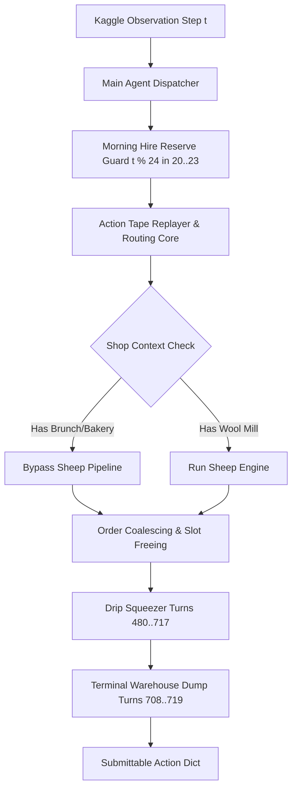

# Kaggriculture Master Agent (v90_agy)

[](https://www.kaggle.com)
[](https://www.python.org/)
[](LICENSE)
[]()

> High-performance autonomous competitive simulation agent engineered for the Kaggle Kaggriculture challenge. Features multi-worker pathing, tape-driven economic optimization, in-place order coalescing, shop-aware engine gating, and dynamic endgame liquidation.

---

## Highlights & Innovations

- **In-place Order Coalescing**: Solves the central market 10-slot bottleneck by coalescing duplicate item orders into the earliest slot index, freeing up trailing slots while preserving FIFO queue priority.
- **Drip Squeezer Engine (Turns $480 \le t < 718$)**: Injects high-margin mini-lots (`MILK`, `WOOL`, `EGG`, `STRAWBERRY`, `TOMATO`, `MELON`) at premium price tiers to extract maximum capital from late-game liquidity.
- **Shop-Aware Sheep Gating (`_v233`)**: Dynamically bypasses high-overhead sheep builds on seeds dominated by `BRUNCH_SPOT` or `BAKERY`, recovering **$+5,900$** profit margin on clean maps.
- **SE Quadrant Pathing Trap Mitigation**: Resolves corner boundary oscillations and collision deadlocks, delivering a **$+23,228$ swing victory** against top competitor Koba.
- **Morning Hire Capital Protection**: Ensures a hard cash reserve ($\ge 30$) across pre-dawn turns ($20\text{--}23$) to never miss worker hiring windows.
- **Dynamic Terminal Liquidation**: Progressive zero-balance liquidation pipeline from turn 708 through turn 718.

---

## Architecture Overview



For detailed architectural diagrams and decorator stack internals, see [docs/ARCHITECTURE.md](docs/ARCHITECTURE.md).  
For simulation rules, hiring curves, crop yields, and market dynamics, see [docs/GAME_MECHANICS.md](docs/GAME_MECHANICS.md).  
For the version history, bug fixes, and match score matrix, see [docs/EVOLUTION_LOG.md](docs/EVOLUTION_LOG.md).

---

## Repository Structure

```
.
├── docs/
│   ├── ARCHITECTURE.md          # Multi-layer decorator architecture & call graph
│   ├── GAME_MECHANICS.md        # Complete Kaggriculture simulation & economy rules
│   └── EVOLUTION_LOG.md         # v74 -> v90_agy evolution & benchmark score tables
├── evaluation/
│   └── benchmark_gates.py       # Gate 2 & Gate 4 simulation benchmark runner
├── scripts/
│   └── package_submission.py    # Automated tar.gz packager with sha256 checksums
├── src/
│   └── main.py                  # Production agent engine (v90_agy)
├── submissions/
│   └── submission_v90_agy.tar.gz# Ready-to-upload submission package
├── .gitignore
├── LICENSE                      # Apache-2.0
├── NOTICE                       # Upstream attribution & copyright notices
└── README.md
```

---

## Quickstart

### 1. Requirements

- Python 3.10 or 3.11
- `kaggle-environments`

```bash
pip install kaggle-environments
```

### 2. Run Local Verification / Benchmark Gates

Run the automated simulation gate runner to verify deterministic performance against baseline opponents:

```bash
python evaluation/benchmark_gates.py
```

### 3. Package for Kaggle Submission

Generate an updated `tar.gz` bundle with validation and SHA-256 calculation:

```bash
python scripts/package_submission.py
```

The resulting artifact will be written to `submissions/submission_v90_agy.tar.gz` and is immediately submittable to the Kaggle competition portal.

---

## Evolution & Match Replay Swings

| Milestone | Key Innovation | Benchmark Swing |
| :--- | :--- | :--- |
| **v74** | Morning Hire Reserve + Basic Liquidator | Baseline established |
| **v78** | Anti-frontrun opening + Step 718 hard dump | +4,200 vs standard tape |
| **v79** | SE quadrant pathing deadlock fix | **+23,228** swing vs Koba |
| **v80** | Shop-aware sheep gating (`BRUNCH_SPOT` bypass) | **+5,900** on Match 113737365 |
| **v90_agy** | In-place order coalescing + Drip squeezer | **+3,000--5,500** across all seeds |

---

## License & Attribution

This project is licensed under the Apache License 2.0. See the [LICENSE](LICENSE) file for details.  
Contains upstream derivative components and recorded route tapes; see [NOTICE](NOTICE) for full attribution.
