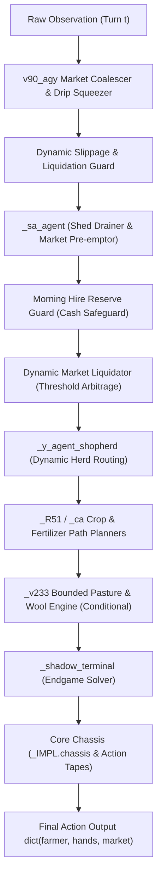

# Architecture Specification: Kaggriculture Master Engine (v90_agy)

## Overview

The **Kaggriculture Master Engine** employs a multi-layered, compositional decorator architecture (often referred to as the "Russian Doll" wrapper pipeline). Rather than relying on a single monolithic decision loop or black-box neural net, the agent combines:
1. **Pre-computed action tapes (Chassis Routes):** High-precision deterministic routes tailored to specific shop unlock pairs.
2. **Dynamic Reactive Middle Layers:** Schedulers that adjust crops, worker assignments, animal herd composition, and fertilizer usage based on emergent game state.
3. **High-Frequency Market Arbitrage & Coalescing Wrappers:** Top-level order-book optimizers that compact orders, front-run market shifts, squeeze high-margin product drips, and manage terminal liquidations.

---

## Architectural Stack Diagram



---

## Layer-by-Layer Decomposition

### 1. Core Chassis & Action Tapes (`_IMPL.chassis`)
- **Origin:** Public V39/V44 chassis derivations.
- **Function:** Contains pre-calculated action trajectories for the primary farmer and hired hands.
- **Route Selection:** Categorizes town shops into shop pairs (e.g., `BAKERY`, `YARN_STORE`, `SMOOTHIE_SHOP`, etc.) and selects the trajectory yielding the highest theoretical upper-bound cash flow.

### 2. Endgame Optimizer (`_shadow_terminal`)
- Simulates terminal states starting around day 27 (step 648+).
- Reassigns workers from repetitive planting/watering routines to warehouse clearing, tile cleanup, and liquidation.

### 3. Conditional Bounded Sheep Engine (`_v233`)
- **Key Breakthrough in v80:**
  In earlier versions (e.g., v78), `_v233` blindly unlocked the Southeast quadrant for 4,000 coins and bought 6 sheep on Day 11 whenever two `YARN_STORE`s were present. In maps with `BRUNCH_SPOT` or `BAKERY`, wheat demand spiked, starving the herd and triggering budget collapse.
- **v80/v90 Logic:** The sheep expansion is strictly gated:
  ```python
  if any(s in ('BRUNCH_SPOT', 'BAKERY') for s in shops):
      return False
  ```
  This preserves the massive wool profits on pure yarn worlds (+5,900 swing) while completely preventing feed-drain bankruptcies on baker worlds (+23,228 swing vs Koba).

### 4. Calibrated Herd Substitution (`_y_agent_shopherd`)
- Dynamically swaps animal purchases between `COW`, `SHEEP`, and `GOOSE` according to real-time shop unlocks and milk/wool/egg multipliers.

### 5. Morning Hire Reserve Guard
- Operates during midnight hours (steps % 24 in {20, 21, 22, 23}).
- Prevents the agent from spending all liquid cash on seeds right before daybreak, ensuring morning worker hire costs (which follow Fibonacci scaling) are fully guaranteed.

### 6. Dynamic Market Liquidator
- Tracks high-value inventory items (`WOOL`, `EGG`, `STRAWBERRY`, `MELON`, `TOMATO`, `CARROT`).
- When town quotes cross target thresholds and step $\ge 480$, automatically schedules incremental sales before competitor selloffs crash the market.

### 7. Flagship Wrapper: v90_agy Optimizers
- **In-place Order Coalescing:** The game restricts market orders to a maximum of 10 slots per turn. If multiple sub-layers place separate orders for the same commodity (e.g., three small `SELL WHEAT` orders), `v90_agy` consolidates them in-place into a single order at the earliest position, preserving execution priority while freeing up critical slots.
- **Drip Squeezer:** Whenever slots are freed ($< 10$ orders), it analyzes prices of animal and high-tier products:
  - For items with market price $\ge 2.0$, it automatically appends mini-lots (`min(lot, have)`) into the transaction queue.
  - Squeezes maximum marginal revenue turn-by-turn without waiting for terminal bulk drops.
- **Terminal Liquidation Guard ($t \ge 708$):** Ensures 100% of stored warehouse inventory is converted to cash before turn 720, guaranteeing zero unrealized assets at game conclusion.
